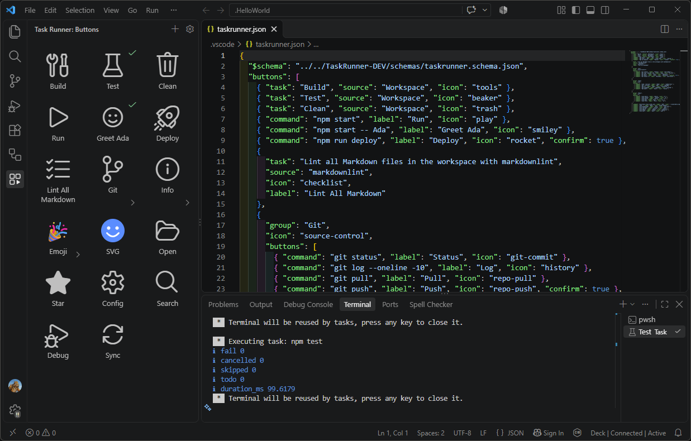

# Task Runner

A VS Code sidebar grid of big, labelled buttons that run your tasks and shell commands with one click.



## Features

- **One-click buttons.** Each button runs a task from `tasks.json` (or any task provider, such as npm) or a plain shell command.
- **Big, readable icons.** Icons range from 32 to 128 px, with optional labels underneath.
- **Flexible icons.** Use a [Codicon](https://microsoft.github.io/vscode-codicons/dist/codicon.html) name, a workspace image (`.svg` or `.png`) or an emoji.
- **Groups.** Nest buttons in folder-like groups to keep the grid tidy.
- **Run status.** A check mark shows on buttons whose last run succeeded.
- **Confirm before running.** Mark deploy-style buttons with `"confirm": true`.
- **Edit in the UI or in the file.** Add buttons, rename them, change icons, remove them and reorder them by drag and drop. Right-click a button for the menu. Everything is stored in a plain JSON file, and your comments are kept when the extension edits it.
- **Schema and completion.** `.vscode/taskrunner.json` is validated against a bundled JSON schema.

## Getting started

1. Click the **Task Runner** icon in the activity bar.
2. Click **+** in the view title to add tasks or commands to the grid. Run **Task Runner: Pick Tasks for the Grid** from the Command Palette to choose from your existing tasks.
3. Click the gear icon to open `.vscode/taskrunner.json` and edit the buttons by hand. If it doesn't exist yet, run **Task Runner: Create Config**.

## Configuration

Buttons live in `.vscode/taskrunner.json`, in the order shown:

```jsonc
{
  "$schema": "../schemas/taskrunner.schema.json",
  "buttons": [
    // Run a task from tasks.json
    { "task": "Build", "source": "Workspace", "icon": "tools" },

    // Run a shell command
    { "command": "npm start", "label": "Run", "icon": "play" },

    // Ask first
    { "command": "npm run deploy", "label": "Deploy", "icon": "rocket", "confirm": true },

    // A group of buttons
    {
      "group": "Git",
      "icon": "source-control",
      "buttons": [
        { "command": "git status", "label": "Status", "icon": "git-commit" },
        { "command": "git push", "label": "Push", "icon": "repo-push", "confirm": true }
      ]
    }
  ]
}
```

### Button properties

A button must have exactly one of `task`, `command`, or `group` with `buttons`.

| Property | Applies to | Description |
| --- | --- | --- |
| `task` | task | Label of the task, as listed in **Terminal > Run Task**. |
| `source` | task | Tells same-named tasks apart: `"Workspace"` for `tasks.json`, or a provider such as `"npm"`. |
| `folder` | task | Workspace folder name, in a multi-root workspace. |
| `command` | command | Shell command to run. Variables such as `${workspaceFolder}` are resolved by VS Code. |
| `cwd` | command | Working directory. Defaults to the workspace folder. |
| `env` | command | Extra environment variables. |
| `shell` | command | Shell executable to use instead of the default, e.g. `"bash"`. |
| `group` | group | Group name. Requires `buttons`, which may contain more groups. |
| `label` | all | Text under the icon. Defaults to the task label or the command. |
| `icon` | all | Codicon name, workspace-relative image, or emoji. Defaults by task group; groups default to `folder`. |
| `tooltip` | all | Hover text. Defaults to what the button will run. |
| `confirm` | task, command | Ask before running. Default `false`. |
| `id` | all | Stable identifier, unique within the file. Derived automatically if omitted. |

> **Windows paths in JSON:** a backslash starts an escape, so `\t` or `\b` silently turns into a control character. Write `.\\scripts\\build.ps1` or use forward slashes.

The full definition is in [schemas/taskrunner.schema.json](schemas/taskrunner.schema.json).

## Settings

| Setting | Default | Description |
| --- | --- | --- |
| `taskRunner.iconSize` | `48` | Icon size in pixels, from 32 to 128 in steps of 8. |
| `taskRunner.showLabels` | `true` | Show labels under icons. When off, the name remains in the tooltip and for screen readers. |
| `taskRunner.columns` | `auto` | Number of columns (1 to 12), or `auto` to fit the sidebar width. |

## Commands

| Command | Description |
| --- | --- |
| Task Runner: Add to the Grid... | Add a task or command button. |
| Task Runner: Pick Tasks for the Grid | Choose from your existing tasks. |
| Task Runner: Open Config | Open `.vscode/taskrunner.json`. |
| Task Runner: Create Config | Create a starter config file. |
| Task Runner: Show Tasks | List the tasks VS Code can see. |

Right-click a button for **Rename**, **Change Icon**, **Edit in File** and **Remove from Grid**.

## Workspace trust

Task Runner has limited support in untrusted workspaces. The buttons are shown, but nothing runs and icons from workspace files aren't loaded until you trust the folder.

## Development

Requires Node.js 22 and VS Code 1.90 or later.

```sh
npm ci
npm run build        # bundle the extension and webview with esbuild
npm run typecheck    # type-check the extension and webview
npm run test:unit    # unit tests (mocha)
npm run test:host    # integration tests inside a VS Code instance
npm test             # all of the above
npm run package      # build .output/taskrunner.vsix
```

To debug, open the repo in VS Code and press **F5**.

The source is split into `src/core` (pure logic), `src/host` (the extension host) and `src/webview` (the grid UI). A manually triggered [CI workflow](.github/workflows/ci.yml) tests on Windows and Linux and uploads the packaged `.vsix`.

### Extension host crash with GitHub Copilot Chat

When the development host starts with Copilot Chat installed, the extension host can abort about a second after launch (exit code 134, with nothing in the logs). It happens only with `--extensionDevelopmentPath`: in that mode Copilot Chat enables API proposals that VS Code's `product.json` doesn't list, and VS Code logs `Proceeding with EXTRA proposals ... EXTENSION WILL BE BROKEN` just before the crash. It is intermittent, and it isn't caused by Task Runner. The extension runs fine with `--disable-extensions`.

The default **Run Extension** launch configuration passes `--disable-extension=GitHub.copilot-chat`, so the development host starts without Copilot Chat. This doesn't affect your normal VS Code windows.

If you launch the development host without Copilot Chat first and then re-enable it, it generally launches fine from then on. I don't know whether a Copilot Chat update brings the crash back. If it does, disable Copilot Chat in the development host again.

## AI disclosure

Most of this extension was written with AI assistance, guided by detailed upfront planning, extensive manual testing and maintainer review. The maintainer reviewed all of the code. See [ACR.md](ACR.md) for the AI Code Rating (A4b).

## Licence

[MIT](LICENSE). Third-party material is listed in [THIRD-PARTY-NOTICES.md](THIRD-PARTY-NOTICES.md).
